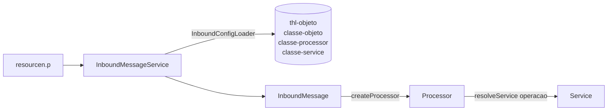

# ADR — Entrada em três camadas: Message → Processor → Service

> **Aceita em 2026-10-04** (decisão do responsável). Aplicada em `thl-lib`, no sistema `thl`, nas telas e nos scripts; **nada foi compilado nem testado**. Depende dos deltas `Database\delta-thl-2026-10-03.df` e `delta-thl-2026-10-04.df`, nessa ordem.
>
> Substitui: a parte "GET no `execute` do Service" de [get-no-execute-do-service.md](get-no-execute-do-service.md) (o `execute` saiu do Service) e a regra "filho por rota própria" de [api-rest-cadastros-thl.md](api-rest-cadastros-thl.md) §6 (o filho virou operação da URL).
>
> Contexto: [arquitetura/InboundMessage.md](../arquitetura/InboundMessage.md) · [arquitetura/Service.md](../arquitetura/Service.md) · [integration/messaging-inbound.md](../integration/messaging-inbound.md) · [extensions/thl.md](../extensions/thl.md)

## 1. Contexto

Depois que o GET passou para o mesmo caminho de POST, PATCH e DELETE, as Messages de cadastro ficaram reduzidas a devolver um Service: uma classe por objeto só para dizer "qual Service". O Service, por sua vez, tinha dois papéis: a regra de negócio e a orquestração da chamada (`execute`: preparar, despachar o verbo, montar a resposta). E a escolha do Service de um filho (`objeto-usuario`, `mensageria/conteudo`) ficava espalhada: ora na Message, por rota; ora dentro do Service, por operação.

## 2. Decisão

Três camadas, cada uma com um papel:

| Camada | Classe | Papel |
|---|---|---|
| Message | `thl-lib.integration.messaging.inbound.core.InboundMessage` (**concreta**) | Protocolo: registro da mensagem, verbo HTTP, referências, conteúdo gravado, resposta. Não conhece regra nem tabela. |
| Processor | `thl-lib.integration.messaging.inbound.core.Processor` (**concreta**) | Orquestração: qual Service atende a operação, ordem das chamadas, resposta. É quem tem o `execute`. |
| Service | `thl-lib.erp.core.Service` (abstrata) | Regra, dados e o JSON da entidade nos dois sentidos. **Sem `execute`.** |

### 2.1 As classes ficam no cadastro do objeto

`thl-objeto` guarda as três classes, pelo nome completo:

| Campo | Inicial | Quando trocar |
|---|---|---|
| `classe-objeto` | `thl-lib.integration.messaging.inbound.core.InboundMessage` | Message específica: máscara de segredo, verbo fora do padrão, validação de payload |
| `classe-processor` | `thl-lib.integration.messaging.inbound.core.Processor` | Agregado: mais de um Service atrás do mesmo objeto |
| `classe-service` | em branco | Sempre informar em objeto de entrada |

O `InboundConfigLoader` recusa objeto de entrada com qualquer das três em branco: "Objeto &1/&2 sem classe obrigatoria no cadastro (thl0021): &3." A mesma regra está no `Pi-validate` do `thl0021-v01.w` e no `ObjetoService`.

### 2.2 Processor concreto: 1 para 1 no padrão, 1 para N na filha

- **Padrão (1 para 1):** `Processor:resolveService( operation )` instancia o Service de `classe-service` (`dynamic-new`, com conferência de tipo). A operação segue para o Service, que pode tratá-la (`mensageria/metricas`).
- **Agregado (1 para N):** uma filha de `Processor` sobrescreve só `resolveService`: sem operação vale o Service do cadastro (`super`); cada filho é uma operação; operação desconhecida lança `ThlError` — nunca cai no Service do pai.

`execute( action, operation, context, output referenceCode )`:

- `Consultado` → `prepareQuery( operation, context )` → `consult()` → `buildQueryResponse()`; não passa pelo `initialize()`.
- demais → `prepare( operation, context )` → `initialize()` → `create()`/`update()`/`delete()` → `loadReferenceCode()` → `buildResponse()`.

Por ser pública e não depender da mensageria, a mesma chamada serve a um `.p` ou RPW: `new Processor()`, `setServiceClass(...)` ou `setService(...)`, `execute(...)`.

### 2.3 Um objeto por agregado; o filho é operação da URL

O pai e os filhos usam **um objeto e uma rota**; o filho é o segundo segmento da URL:

| Objeto | Processor | URL → Service |
|---|---|---|
| `PARAMETRO` | `ParametroProcessor` | `parametro-ambiente` → `ParametroAmbienteService` · `/variavel` → `ParametroVariavelService` · `/programa` → `ParametroProgramaService` |
| `OBJETO` | `ObjetoProcessor` | `objeto` → `ObjetoService` · `/parametro` → `ObjetoParametroService` · `/usuario` → `ObjetoUsuarioService` |
| `CONEXAO-REST` | `ConexaoRestProcessor` | `conexao-rest` → `ConexaoRestService` · `/autenticacao` · `/header` |
| `AUDIT-TABELA` | `AuditoriaTabelaProcessor` | `auditoria-tabela` → `AuditoriaTabelaService` · `/acesso` · `/campo` · `/notificacao` · `/expurgo` |
| `GRUPO-EMAIL` | `GrupoEmailProcessor` | `grupo-email` → `GrupoEmailService` · `/usuario` → `GrupoEmailUsuarioService` |
| mensageria | `MensageriaProcessor` | `mensageria` e `/metricas` → `MensageriaService` · `/conteudo` → `MensageriaConteudoService` |

Objetos com um Service só (ambiente, aplicação, path, rota inbound, parâmetro de e-mail, e-mail, auditoria) usam o Processor padrão.

O impedimento antigo — a chave de `thl-objeto-parametro` não inclui o método, então a operação na URL só admitia um verbo — foi resolvido no carregador, sem mexer no banco. `InboundConfigLoader:findParameter` procura a linha nesta ordem:

1. operação da URL + método;
2. método com operação em branco;
3. método com operação igual ao nome do método (`GET`, `POST`, `PATCH`, `DELETE`);
4. primeira linha do método.

Assim as quatro linhas por método do objeto atendem o pai e todos os filhos. Uma operação só ganha linha própria quando precisa de parâmetro diferente (ex.: `metricas` com gravação de conteúdo "somente em erro"). A operação da URL é sempre a que fica na configuração e gravada na mensagem.

### 2.4 Carregador com pai e duas filhas

| Classe | Papel |
|---|---|
| `thl-lib.integration.messaging.repository.MessageConfigLoader` (abstrata) | Buffers, `findObject`, `buildConfig` |
| `…messaging.outbound.repository.OutboundConfigLoader` | Busca por estabelecimento/aplicação/objeto/operação; devolve `MessageConfig` |
| `…messaging.inbound.repository.InboundConfigLoader` | Busca por método e operação (§2.3), valida as classes; devolve `InboundMessageConfig` (com `processorClass` e `serviceClass`) |

A saída não lê nem valida processor e service.

### 2.5 Messages específicas

- **Continuam** (têm comportamento próprio): `ParametroAmbienteMessage` e `ConexaoRestMessage` (máscara de segredo no conteúdo gravado) e as Messages de `thl-lib` e das outras extensões.
- **Retiradas** (eram 1 para 1): 11 Messages do sistema `thl`, renomeadas para `.cls.old` na própria pasta — não compilam nem contam como classe.
- **Compatibilidade:** `InboundMessage:createService()` deixou de ser abstrato e devolve `?`. A Message antiga que ainda o sobrescreve entrega a instância ao Processor (`setService`), que a usa no lugar do cadastro. Mesmo assim o cadastro precisa ter `classe-service` preenchida — o carregador valida antes.

## 3. Alternativas descartadas

- **Tabela nova para as classes.** Mais flexível (classe por operação), mas um cadastro a mais para manter e uma leitura a mais por requisição. Dois campos em `thl-objeto` com valor inicial resolvem.
- **Service na operação (`thl-objeto-parametro`).** Dispensaria os Processors de agregado, mas exigiria uma linha por filho × verbo (o objetivo era o contrário: menos cadastro) e deixaria a composição do agregado só no banco, sem conferência do compilador.
- **Processor abstrato.** Obrigaria uma classe por objeto, repetindo o problema das Messages 1 para 1.
- **Manter o `execute` no Service.** Deixa a orquestração e a regra na mesma classe e impede a escolha do Service por fora dele.

## 4. Consequências

**A favor:** cadastro novo 1 para 1 = só o Service + o registro do objeto; um objeto por agregado (menos cadastro, visibilidade por `thl-objeto-usuario` vale para o agregado); escolha do Service em um lugar só; o Service fica testável verbo a verbo.

**Contra / riscos:**

- **Objetos de entrada já cadastrados param** até `classe-service` ser preenchida — rodar `Utils\scripts\acerto-thl-objeto-classes.p` logo após o delta.
- **URLs dos filhos mudaram** (`objeto-usuario` → `objeto/usuario`): o app web e a coleção Postman precisam acompanhar. As rotas antigas dos filhos são desativadas pela carga; ativas, cairiam no Service do pai.
- Os verbos do `Service` passaram de `protected` para `public` (o Processor é outra classe): 211 declarações em 43 arquivos. Uma filha fora do repositório com `protected override` deixa de compilar.
- `LoogAiDocumentoService` sobrescrevia `execute`; a lógica foi para `create()`.
- Quem chamava `Service:execute` fora do repositório deixa de compilar — passar a usar `Processor`.
- Nome de classe em três campos de banco: mover ou renomear Message, Processor ou Service exige atualizar `thl-objeto`.
- Mensagem inbound **agendada** de uma operação sem linha própria: o RPW reprocessa pela operação gravada; conferir no teste se o carregador é o mesmo.

## 5. Implantação (ordem)

1. Carregar `delta-thl-2026-10-03.df` e depois `delta-thl-2026-10-04.df`.
2. Compilar `thl-lib`, `thl-extensions` e `thl`.
3. `Utils\scripts\acerto-thl-objeto-classes.p` (simulação por padrão): preenche processor e service dos objetos de entrada existentes e troca as Messages retiradas pela padrão. Conferir no log os "sem regra".
4. `Utils\scripts\carga-thl-api-cadastros.p` (simulação por padrão): objetos da API de cadastros, parâmetros, rotas; desativa as rotas próprias dos filhos. Alternativa pelos endpoints: `cadastrar-thl-api-rotas.ps1`.
5. Ajustar o app web (URLs dos filhos) e conferir a coleção Postman.
6. Eliminar os objetos próprios dos filhos que a carga apontar como "sem uso" (`thl0021`/`thl0022`, ou o `.ps1` com `-EliminarObsoletos`).

## 6. A testar

- Cada objeto × verbo, com e sem operação; operação desconhecida em agregado devolve erro.
- Objeto de entrada sem `classe-service` devolve o erro do carregador.
- Message antiga (`NotaFiscalMessage`, `LpcoMessage`…) continua usando o Service que ela mesma cria.
- `mensageria/conteudo` e `mensageria/metricas`.
- Máscara de segredo em `parametro-ambiente/variavel` e `conexao-rest/autenticacao`.
- Saída (`OutboundMessageService`) — só trocou o carregador.
- Documento Loog.ai (POST): frete real gravado depois do documento.

## 7. Segunda rodada (2026-10-04) — consultas de `thl-lib` e escolha por operação no Processor

Aplicada no mesmo dia, sem compilação.

- **`consult()` nos Services de consulta de `thl-lib`:** `ItemService`, `SaldoService`, `CentroCustoService`, `EmitenteService`, `LocalEntregaService` e `TransporteService`. Cada um lê os mesmos parâmetros de query que a Message lia e chama o `get(...)` que já existia (mantido). A resposta é o mesmo `JsonObject` — objeto único segue como veio.
- **Processors por operação:** `thl-lib.integration.messaging.inbound.process.ItemProcessor` (`Saldo` → `SaldoService`), `EmitenteProcessor` (`localentrega` → `LocalEntregaService`), `RequisicaoProcessor` (`item` → `ItemRequisicaoService`) e `thl-extensions.integration.dvv.messaging.inbound.process.FreteProcessor` (`previsto` → `FretePrevistoService`; `realizado` e qualquer outra → erro). Os três de `thl-lib` mantêm o comportamento antigo: operação não listada usa o Service do cadastro.
- **Messages retiradas (`.cls.old`):** `CentroCustoMessage`, `EmitenteMessage`, `ItemMessage`, `TransporteMessage`.
- **Messages que ficaram, sem `createService()`:** `RequisicaoMessage` (campos obrigatórios no DELETE, referência externa desligada) e `FreteMessage` (campos obrigatórios).
- **Não migradas:** `LpcoMessage` (o GET devolve `JsonArray` com paginação real; pelo `consult()` a resposta viraria `{ items, hasNext: false }` — muda o contrato com o sistema externo) e `NotaFiscalMessage` (escolhe o Service pela **rota**, `notafiscal` × `notafiscal/embarque`, e o Processor só recebe a operação — depende de como a rota está cadastrada).

⚠️ **Cadastro:** objetos que apontam para as quatro Messages retiradas deixam de instanciar (`dynamic-new` de classe inexistente) até o `acerto-thl-objeto-classes.p` trocar para a Message padrão. Requisição e frete precisam do Processor novo no cadastro: com o Processor padrão, `requisicao/item` cairia no `RequisicaoService` e o frete aceitaria qualquer modalidade. O acerto cobre os seis casos.

**A testar:** GET de item, saldo, centro de custo, emitente, local de entrega e transporte com os mesmos parâmetros de antes (resposta idêntica); item da mensagem gravado com a referência; DELETE de `requisicao/item`; frete `previsto`, `realizado` e modalidade inválida.

## 8. Terceira rodada (2026-10-05) — contrato no cadastro

Continuação em [operacao-acao-extensao-rest.md](operacao-acao-extensao-rest.md): ação neutra na chave da operação, classes por operação (sobrepõem as do objeto), extensão REST com verbo, campos obrigatórios e chave externa. Com isso `LpcoMessage` foi migrada (o `LpcoService` ganhou `consult()`) e saíram também `DocumentoMessage`, `EmbarqueMessage`, `RequisicaoMessage`, `UsuarioMessage`, `FreteMessage`, `LoogAiDocumentoMessage`, `LoogAiEmbarqueMessage` e `NinahubNotaFiscalMessage`. Restam três Messages de entrada: `NotaFiscalMessage`, `ParametroAmbienteMessage` e `ConexaoRestMessage`. A ordem de implantação da §5 foi substituída pela daquele ADR (cargas antes do acerto).

## Pacote dos Processors (2026-10-06)

Os Processors são orquestração da **entrada** e ficam junto dela: `thl-lib.integration.messaging.inbound.process` (`Fontes	hl-lib\integration\messaging\inbound\process\`) e, nas extensões, `thl-extensions.integration.<sistema>.messaging.inbound.process`. Os Services continuam em `erp.service`. Decisão do responsável; nada mais muda no desenho. Onde este ADR citava `erp.process`, o texto já foi atualizado.

## Processor base em `core` (2026-10-07)

A classe-base `Processor` foi para `thl-lib.integration.messaging.inbound.core` (`Fontes\thl-lib\integration\messaging\inbound\core\Processor.cls`), ao lado de `InboundMessage` e `InboundMessageConfig` — o mesmo padrão das Messages: base em `core`, específicas em pasta própria. Os Processors específicos continuam em `…messaging.inbound.process` (em `thl-lib`: item, emitente, requisição, nota fiscal; nas extensões: `dvv` e `thl`). Como o delta de 2026-10-04 já estava carregado, o valor inicial de `thl-objeto.classe-processor` é corrigido pelo `delta-thl-2026-10-07.df`, e o `acerto-thl-objeto-classes.p` (passo 0) troca nos cadastros os nomes gravados com pacote antigo — da classe-base e dos específicos.

## Processor chama o método da operação (2026-10-08, não compilado)

Decisão do responsável: o Processor é o orquestrador e é ele que chama o método do Service. Com **um método por ação** vale o Processor padrão (mesmo com vários Services, como `item` e `item/Saldo`). Com **várias operações na mesma ação**, o objeto tem Processor próprio.

- `Processor` (base): a chamada do verbo saiu do `execute` para `invokeWrite( action, service, operation )`, protegido; o padrão continua `create`/`update`/`delete`. Preparo, referência e resposta seguem na base.
- `NotaFiscalBaseService`: etapas como métodos públicos abstratos — `generateInvoice`, `generateNfeXml`, `authorizeSefaz`, `printInvoice`, `notifyInvoice` — e `waitSefazProcessing` (a espera da SEFAZ, variável `intervalo.processamento`). `NotaFiscalService` e `NotaFiscalPorEmbarqueService` implementam delegando aos métodos que já existiam; o `case this-object:operation` saiu do `create()`, que ficou sendo a geração.
- `NotaFiscalProcessor`: sobrescreve `invokeWrite` e, no POST, chama o método da etapa; `processamento` (só nota direta) virou o encadeamento no Processor, na mesma transacao de antes. Continua separando `embarque/<etapa>` para escolher o Service.
- **Ninahub:** `NinahubNotaFiscalService` herda de `NotaFiscalService`; o objeto `NotaFiscal` da Ninahub precisa do `NotaFiscalProcessor` em `thl-objeto.classe-processor` (acerto e `.d` ajustados). Com o Processor padrão, **toda** operação passaria a cair em `create()` = geração.
- Mudança de contrato: as etapas ficaram públicas nos dois Services; quem chamava `create()` com a operação preenchida para escolher a etapa (não achei nenhum chamador fora da entrada REST) precisa chamar o método da etapa.
- Mesmo padrão ainda no Service, na consulta: `MensageriaService`, `AuditoriaService` e `EmailService` leem a operação `metricas` dentro do `consult()`. Não foram alterados.
- Os três Services de nota fiscal e o `NinahubNotaFiscalService` estavam em UTF-8 com LF; foram convertidos para **ISO-8859-1 com CRLF** (o único caractere fora do ASCII era o travessão dos comentários, trocado por hífen).

**A testar:** cada etapa pelas duas URLs (`notafiscal/<etapa>` e `notafiscal/embarque/<etapa>`); `processamento`; etapa inexistente (erro); `ninahub/NotaFiscal/<etapa>` com o Processor novo; um objeto comum (Embarque: POST, PATCH, DELETE) para confirmar que o padrão não mudou.

## Métricas: o Processor chama `consultMetrics()` (2026-10-08, não compilado)

O mesmo critério na consulta: listagem e métricas são duas operações do GET, então quem escolhe o método é o Processor.

- `Processor` (base): `invokeQuery( service, operation )`, protegido; o padrão chama `consult()`.
- `thl-extensions.erp.thl.interfaces.IMetricsService` (nova; o ADR dizia `thl-lib.erp.interfaces`, mas o código está em `thl-extensions`): `consultMetrics()`.
- `thl-extensions.integration.thl.messaging.inbound.process.MetricsProcessor` (novo; o ADR dizia `thl-lib.integration.messaging.inbound.process`, mas o código está em `thl-extensions`): na operação `metricas` chama `consultMetrics()`; qualquer outra segue para o `consult()`, como antes. Service sem a interface → erro.
- `MensageriaService`, `AuditoriaService`, `EmailService`: implementam a interface; o `consult()` ficou só com a listagem (saiu a leitura de `this-object:operation`).
- `MensageriaProcessor` herda de `MetricsProcessor` (continua desviando `conteudo`).
- **Cadastro:** os objetos `Auditoria` e `Email` precisam do `MetricsProcessor` em `thl-objeto.classe-processor` (acerto e `.d` ajustados). ⚠️ Com o Processor padrão, `<rota>/metricas` passa a devolver a **listagem**, sem erro.

**A testar:** `mensageria`, `mensageria/metricas`, `mensageria/conteudo`, `auditoria`, `auditoria/metricas`, `email`, `email/metricas`; uma consulta comum (`item`) para confirmar que o padrão não mudou.

## Service do filho no cadastro; saem os Processors de agregado (2026-10-08, não compilado)

Decisão do responsável: escolher Service não justifica Processor. `thl-objeto-parametro.classe-service` já existia para isso; os Processors de agregado tinham o `new <Service>()` fixo e passavam por cima do cadastro.

- **Retirados (`.cls.old`):** `ItemProcessor`, `EmitenteProcessor`, `RequisicaoProcessor` (thl-lib); `MensageriaProcessor`, `ParametroProcessor`, `ObjetoProcessor`, `ConexaoRestProcessor`, `AuditoriaTabelaProcessor`, `GrupoEmailProcessor` (thl).
- **Ficam:** `NotaFiscalProcessor` e `MetricsProcessor` (chamam métodos diferentes na mesma ação). O `FreteProcessor` também foi retirado (`.cls.old`): o objeto Frete usa o Processor padrão e o `FretePrevistoService` do cadastro; a recusa de modalidade diferente de `previsto` passou para o `initialize()` do Service (conferência do que ele atende, não escolha de método). Quando existir `frete/realizado`, basta a linha da operação com o Service dela.
- **Cadastro:** cada filho passa a ter linha própria de operação, por método, com o Service em `classe-service`:

| Objeto (Service do pai) | Operação → Service | Métodos |
|---|---|---|
| Item | `Saldo` → `SaldoService` | GET |
| Emitente | `localentrega` → `LocalEntregaService` | GET |
| Requisicao | `item` → `ItemRequisicaoService` | DELETE |
| Mensageria | `conteudo` → `MensageriaConteudoService` (objeto passa a usar o `MetricsProcessor`) | GET |
| ParametroAmbiente | `variavel`, `programa` | os do pai |
| Objeto | `parametro`, `usuario` | os do pai |
| ConexaoRest | `autenticacao`, `header` | os do pai |
| AuditoriaTabela | `acesso`, `campo`, `notificacao`, `expurgo` | os do pai |
| GrupoEmail | `usuario` | os do pai |

- **`Utils\scripts\acerto-thl-operacao-service.p` (novo):** para a base existente — cria as linhas dos filhos copiando a linha genérica do pai (operação em branco ou com o nome do verbo), com a extensão REST, e troca o Processor retirado pelo padrão (`MensageriaProcessor` → `MetricsProcessor`). Simulação por padrão.
- `acerto-thl-objeto-classes.p`, `carga-thl-api-cadastros.p` e `cadastrar-thl-api-rotas.ps1` deixaram de gravar os Processors retirados; as linhas dos filhos vêm do acerto novo. Cargas `.d` de entrada: 118 operações (70 + 48 de filhos).

⚠️ **Risco assumido:** operação da URL sem linha própria cai na linha em branco do método e usa o Service do **pai**, sem erro (antes o Processor lançava "Operacao nao reconhecida"). O comportamento de cair na linha em branco não pode ser desligado: nota fiscal, frete e métricas dependem dele.

⚠️ **Ordem de implantação:** rodar o acerto novo **antes** de usar os fontes sem os Processors — objeto que ainda aponta para Processor retirado não instancia, e filho sem linha cai no Service do pai.

**A testar:** cada filho pelos verbos que usa (`item/Saldo`, `emitente/localentrega`, `requisicao/item` DELETE, `mensageria/conteudo`, `objeto/usuario`, `parametro-ambiente/variavel`…), o pai sem operação, e uma operação inexistente (hoje cai no pai).
