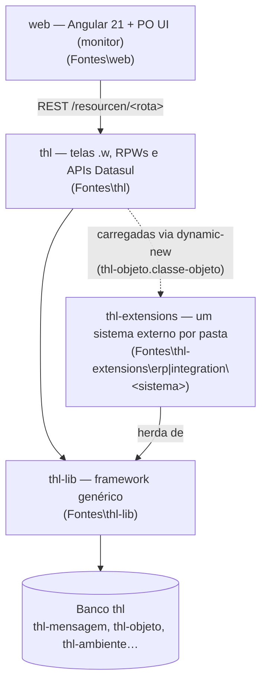
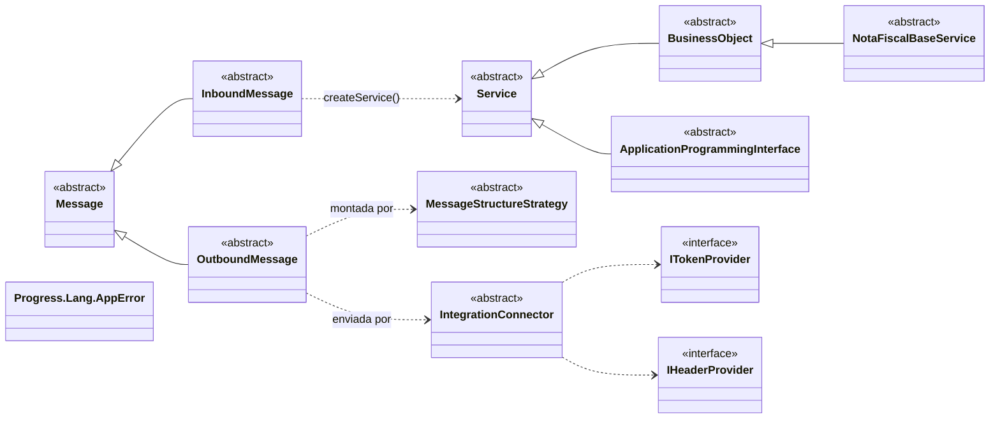
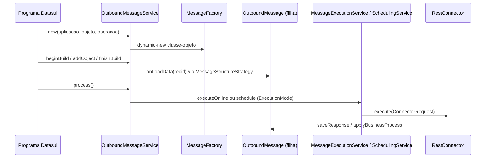
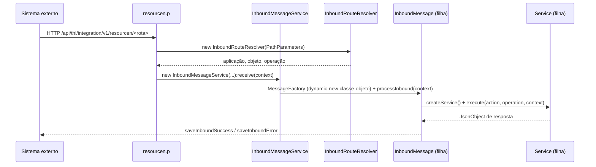

# Arquitetura da THL-Library

> Nota central (hub) criada em 2026-09-24 a partir do código em `Fontes\` (126 classes). Mostra as camadas, os fluxos e as **hierarquias de classe**: das classes-base até as filhas. Cada classe-base tem uma nota própria em [arquitetura/](arquitetura/Message.md); o detalhe de cada pacote continua nas notas de pacote (ver [INDEX.md](INDEX.md)).

## 1. Camadas

| Camada | Contém | Nota |
|---|---|---|
| `thl` | Telas de cadastro/monitor, `resourcen.p` (API REST), `geterpuser.p` | [thl/camada-datasul.md](thl/camada-datasul.md) |
| `thl-lib` | Mensageria, conectores, serviços ERP, e-mail, erros, log, utilitários | pacotes abaixo |
| `thl-extensions` | Mensagens, serviços e providers de cada sistema externo | [extensions/](extensions/loogai.md) |
| `web` | Apps Angular 21 + PO UI (consulta/monitor e cadastro), consome `resourcen.p` | [web/app-web.md](web/app-web.md) · referência PO UI [poui/INDEX.md](poui/INDEX.md) |

Regras de camada: [convencoes.md](convencoes.md) (pacote = pasta em minúsculas; nada de tabela de cliente em `thl-lib`).

## 2. Mapa das hierarquias

Só as classes-base e as sub-bases. Clique na nota de cada uma para ver as filhas.

| Classe-base | Pacote | Filhas diretas | Nota |
|---|---|---|---|
| `Message` | `thl-lib.integration.messaging.core` | 2 | [Message](arquitetura/Message.md) |
| `InboundMessage` | `…messaging.inbound.core` | 22 (+2 netas) | [InboundMessage](arquitetura/InboundMessage.md) |
| `OutboundMessage` | `…messaging.outbound.core` | 11 | [OutboundMessage](arquitetura/OutboundMessage.md) |
| `MessageStructureStrategy` | `…messaging.outbound.strategy` | 2 | [MessageStructureStrategy](arquitetura/MessageStructureStrategy.md) |
| `Service` | `thl-lib.erp.core` | 35 (inclui as sub-bases BO/API) | [Service](arquitetura/Service.md) |
| `BusinessObject` | `thl-lib.erp.core` | 5 (+3 netas) | [BusinessObject](arquitetura/BusinessObject.md) |
| `IntegrationConnector` | `…connectors.types` | 1 | [IntegrationConnector](arquitetura/IntegrationConnector.md) |
| `ITokenProvider` | `…connectors.auth.interfaces` | 1 | [ITokenProvider](arquitetura/ITokenProvider.md) |
| `IHeaderProvider` | `…connectors.headers.interfaces` | 1 | [IHeaderProvider](arquitetura/IHeaderProvider.md) |
| `Progress.Lang.AppError` | (OpenEdge) | 2 | [AppError](arquitetura/AppError.md) |

Fora do mapa: `IFileEnricher` (`thl-lib.util.scanner`, implementada por `FileContentSearcher`) — ver [util/util.md](util/util.md). As demais classes (factories, repositórios, serviços de orquestração, utilitários) não participam de herança.

## 3. Fluxos principais

### Outbound (Datasul → sistema externo)

Detalhe: [integration/messaging-outbound.md](integration/messaging-outbound.md).

### Inbound (sistema externo → Datasul)

Detalhe: [integration/messaging-inbound.md](integration/messaging-inbound.md) e [erp/erp-services.md](erp/erp-services.md).

## 4. Onde estender

| Quero… | Herdo/implemento | Onde fica |
|---|---|---|
| Enviar dados a um sistema externo | [OutboundMessage](arquitetura/OutboundMessage.md) (`onLoadData`) | `thl-extensions\integration\<sistema>\messaging\outbound\message\` |
| Receber dados de um sistema externo | [InboundMessage](arquitetura/InboundMessage.md) (`createService`) | `thl-lib\…\inbound\message\` (genérica) ou `thl-extensions\integration\<sistema>\…` |
| Regra de negócio chamada pela mensagem | [Service](arquitetura/Service.md) / [BusinessObject](arquitetura/BusinessObject.md) | `thl-lib\erp\service\` ou `thl-extensions\erp\<sistema>\service\` |
| Autenticação própria | [ITokenProvider](arquitetura/ITokenProvider.md) | `thl-extensions\integration\<sistema>\connectors\auth\` |
| Cabeçalhos HTTP próprios | [IHeaderProvider](arquitetura/IHeaderProvider.md) | `thl-extensions\integration\<sistema>\connectors\headers\` |

Toda classe carregada por `dynamic-new` precisa estar cadastrada com o nome completo do pacote (`thl-objeto.classe-objeto`, `thl-conexao-rest-autenticacao.classe-parser-token`, `thl-conexao-rest-header.classe-parser`).

## 5. Sistemas externos

[automatizador](extensions/automatizador.md) · [dvv](extensions/dvv.md) · [gestaoepi](extensions/gestaoepi.md) · [iacompras](extensions/iacompras.md) · [loogai](extensions/loogai.md) · [mmcm](extensions/mmcm.md) · [ninahub](extensions/ninahub.md) · [powerautomate](extensions/powerautomate.md) · [thl](extensions/thl.md) (API REST dos cadastros do próprio THL)
