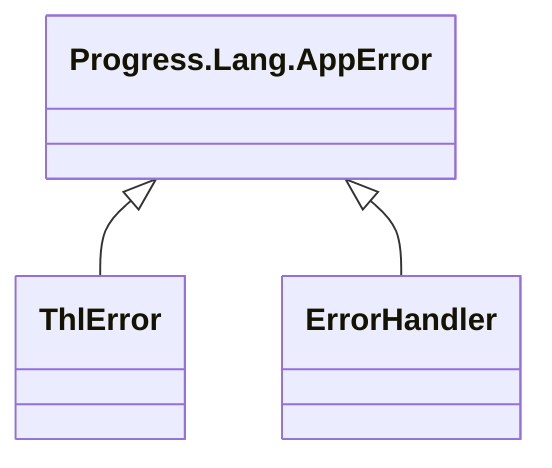

# AppError (erros da THL)

> Base **do OpenEdge** · `Progress.Lang.AppError` · filhas em `Fontes\thl-lib\core\error\` · volta ao [hub de arquitetura](../arquitetura.md)

## Papel

As duas classes de erro da THL-Library herdam da `AppError` nativa, por isso podem ser lançadas com `undo, throw` e capturadas com `catch … as Progress.Lang.Error`.

## Hierarquia

## Filhas

| Classe | Uso |
|---|---|
| `thl-lib.core.error.ThlError` | Exceção lançada pelo framework: `new ThlError(className, methodName, mensagem …)` (4 construtores) |
| `thl-lib.core.error.ErrorHandler` | Acumulador de erros: `addError`, `hasErrors`, `throwIfHasErrors`, `throwError`; converte erro em status HTTP e JSON (`getErrorStatusCode`, `getErrorJsonText`). Usado por `Message`, `BusinessObject` e `ApplicationProgrammingInterface` |

⚠️ `ErrorHandler` herda de `AppError`, mas é usado como utilitário (composição), não como exceção — ponto de design a revisar.

## Relacionados

[core/error.md](../core/error.md) · [BusinessObject](BusinessObject.md) · [Message](Message.md)
