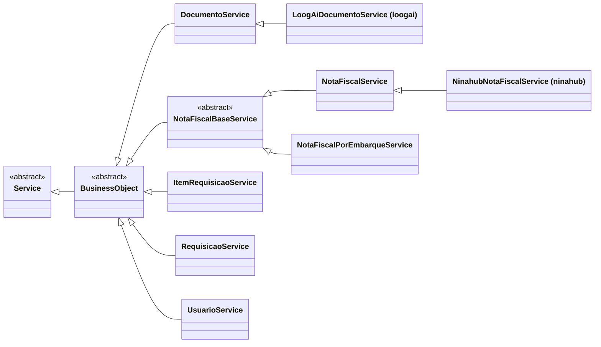

# BusinessObject

> Sub-base **abstrata** · `thl-lib.erp.core.BusinessObject` · herda de [Service](Service.md) · `Fontes\thl-lib\erp\core\BusinessObject.cls` · volta ao [hub de arquitetura](../arquitetura.md)

## Papel

Base dos serviços que chamam **BOs Datasul** (programas que devolvem erros em `RowErrors`). Acrescenta ao [Service](Service.md) um `ErrorHandler` (`error`) e a conversão dos `RowErrors` em exceção.

## Contrato para as filhas

Mantém os abstratos de `Service` (`loadReferenceCode()`, `getEntityName()`) e oferece:

| Membro | Uso |
|---|---|
| `throwRowErrorsIfAny(methodName)` (+ sobrecarga) | Após chamar o BO: lança `ThlError` se houver `RowErrors` |
| `error` (protected, `ErrorHandler`) | Acúmulo de erros |

## Hierarquia

## Filhas

**Em `thl-lib.erp.service`:**

| Classe | Observação |
|---|---|
| `DocumentoService` | Estendida por `LoogAiDocumentoService` ([loogai](../extensions/loogai.md)) |
| `ItemRequisicaoService` | |
| `RequisicaoService` | |
| `UsuarioService` | |
| `NotaFiscalBaseService` (**abstrata**) | Base de NF-e: exportação de XML, autorização SEFAZ (tentativas/pausa por parâmetro de ambiente), impressão de DANFE |
| ↳ `NotaFiscalService` | Estendida por `NinahubNotaFiscalService` ([ninahub](../extensions/ninahub.md)) |
| ↳ `NotaFiscalPorEmbarqueService` | |

## Relacionados

[Service](Service.md) · [erp/erp-services.md](../erp/erp-services.md) · [core/error.md](../core/error.md)
