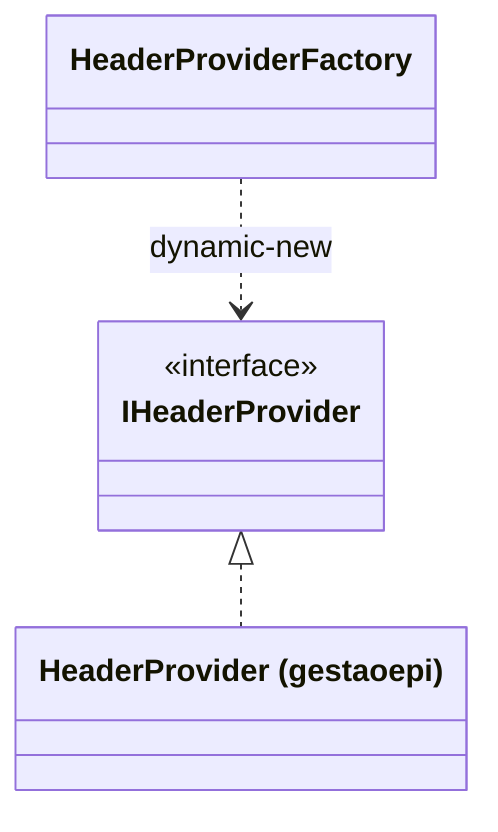

# IHeaderProvider

> **Interface** · `thl-lib.integration.connectors.headers.interfaces.IHeaderProvider` · `Fontes\thl-lib\integration\connectors\headers\interfaces\IHeaderProvider.cls` · volta ao [hub de arquitetura](../arquitetura.md)

## Papel

Ponto de extensão para gerar **cabeçalhos HTTP** calculados (ex.: assinatura do corpo). `HeaderProviderFactory` instancia a implementação com `dynamic-new`, a partir de `thl-conexao-rest-header.classe-parser`; o parâmetro vem do campo `parameters`.

## Contrato

```abl
method public JsonArray getHeaders ( body       as longchar ,
                                     parameters as character ).
```

## Hierarquia



## Implementações

| Classe | Sistema |
|---|---|
| `thl-extensions.integration.gestaoepi.connectors.headers.HeaderProvider` | [gestaoepi](../extensions/gestaoepi.md) |

## Relacionados

[IntegrationConnector](IntegrationConnector.md) · [ITokenProvider](ITokenProvider.md) · [integration/connectors.md](../integration/connectors.md)
