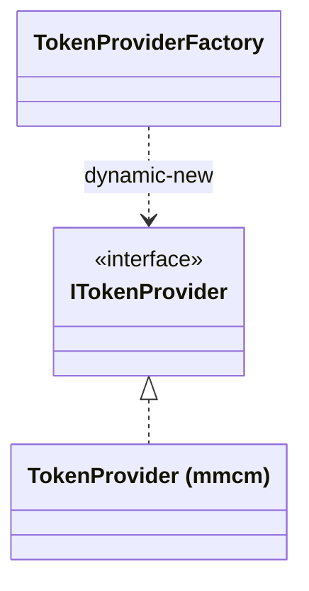

# ITokenProvider

> **Interface** · `thl-lib.integration.connectors.auth.interfaces.ITokenProvider` · `Fontes\thl-lib\integration\connectors\auth\interfaces\ITokenProvider.cls` · volta ao [hub de arquitetura](../arquitetura.md)

## Papel

Ponto de extensão para interpretar a **resposta de autenticação** de um sistema externo quando o formato foge do padrão. `TokenProviderFactory` instancia a implementação com `dynamic-new`, a partir do nome gravado em `thl-conexao-rest-autenticacao.classe-parser-token`.

## Contrato

```abl
method public void parsingToken ( authentication as AuthenticationConfig,
                                  response       as JsonObject          ).
```

## Hierarquia



## Implementações

| Classe | Sistema |
|---|---|
| `thl-extensions.integration.mmcm.connectors.auth.TokenProvider` | [mmcm](../extensions/mmcm.md) |

## Relacionados

[IntegrationConnector](IntegrationConnector.md) · [IHeaderProvider](IHeaderProvider.md) · [integration/connectors.md](../integration/connectors.md)
