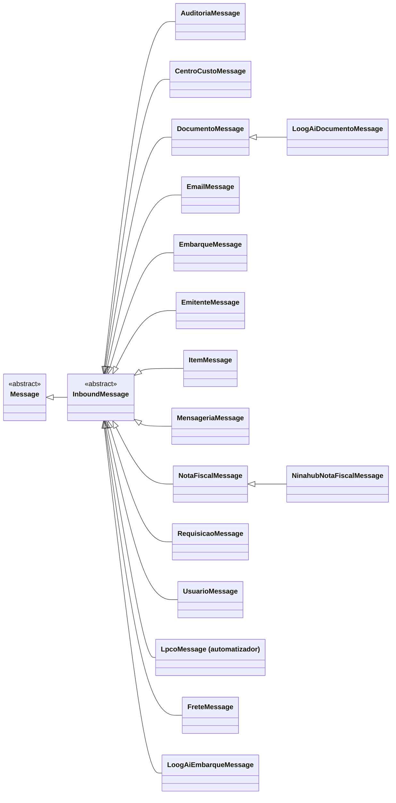

# InboundMessage

> Classe-base **abstrata** · `thl-lib.integration.messaging.inbound.core.InboundMessage` · herda de [Message](Message.md) · `Fontes\thl-lib\integration\messaging\inbound\core\InboundMessage.cls` · volta ao [hub de arquitetura](../arquitetura.md)

## Papel

Mensagem **recebida** pela API REST (`resourcen.p` → `InboundMessageService`). Aplica o **Template Method**: `processInbound(context)` → `dispatchInbound()` → verbo (`methodPost/Patch/Delete/Get`) → `executeService(action)`, que chama o [Service](Service.md) devolvido pela filha (**Factory Method** `createService()`).

## Contrato para as filhas

| Membro | Obrigatório? | Uso |
|---|---|---|
| `createService()` → `Service` | **abstrato** | Devolve o serviço ERP que executa a regra |
| `getRequiredFields()` | opcional | Campos obrigatórios do payload |
| `validate(payload)` / `validatePayload(payload)` | opcional | Validação específica |
| `methodPost/Patch/Delete/Get()` | opcional | Sobrescrever só quando o verbo foge do padrão `executeService` |
| `getExternalReferenceField()` | opcional | Campo do payload que vira `externalReferenceCode` |
| `createPagination(defaultPageSize)` | apoio | Paginação em GET |

Construtor: `(objectName, applicationName, integrationOperation, methodType, …)` — chamado por `MessageFactory` via `dynamic-new` com o nome gravado em `thl-objeto.classe-objeto`.

## Hierarquia

## Filhas

**Genéricas — `thl-lib.integration.messaging.inbound.message`** (9): `CentroCustoMessage`, `DocumentoMessage`, `EmbarqueMessage`, `EmitenteMessage`, `ItemMessage`, `NotaFiscalMessage`, `RequisicaoMessage`, `TransporteMessage`, `UsuarioMessage`. (`AuditoriaMessage`, `EmailMessage` e `MensageriaMessage` passaram para `thl-extensions.integration.thl.messaging.inbound.message` — conferido em disco em 2026-10-02.) Detalhe em [messaging-inbound.md](../integration/messaging-inbound.md).

**De sistemas externos — `thl-extensions.integration.<sistema>.messaging.inbound.message`:**

| Classe | Herda de | Sistema |
|---|---|---|
| `LpcoMessage` | `InboundMessage` | [automatizador](../extensions/automatizador.md) |
| `FreteMessage` | `InboundMessage` | [dvv](../extensions/dvv.md) |
| `LoogAiEmbarqueMessage` | `InboundMessage` | [loogai](../extensions/loogai.md) |
| `LoogAiDocumentoMessage` | `DocumentoMessage` | [loogai](../extensions/loogai.md) |
| `NinahubNotaFiscalMessage` | `NotaFiscalMessage` | [ninahub](../extensions/ninahub.md) |
| `AmbienteMessage`, `AplicacaoMessage`, `ConexaoRestPathMessage`, `InboundRotaMessage`, `EmailParametroMessage`, `AuditoriaMessage`, `EmailMessage`, `MensageriaMessage` | `InboundMessage` | [thl](../extensions/thl.md) |
| `ParametroAmbienteMessage`, `ObjetoMessage`, `ConexaoRestMessage`, `AuditoriaTabelaMessage`, `GrupoEmailMessage` — **uma Message por agregado** (pai + filhos) desde 2026-10-02: `createService()` escolhe o Service de cada tabela por `context:routePath` | `InboundMessage` | [thl](../extensions/thl.md) |

## Relacionados

[Service](Service.md) (o que `createService()` devolve) · [integration/messaging-inbound.md](../integration/messaging-inbound.md) · [erp/erp-services.md](../erp/erp-services.md)
