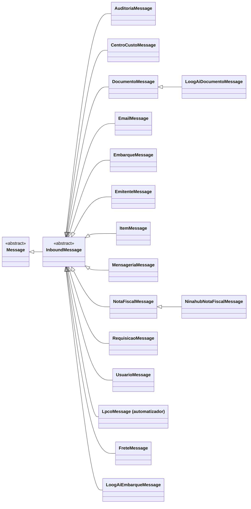

# InboundMessage

> Classe-base **concreta desde 2026-10-04** (é a Message padrão do cadastro) · `thl-lib.integration.messaging.inbound.core.InboundMessage` · herda de [Message](Message.md) · `Fontes\thl-lib\integration\messaging\inbound\core\InboundMessage.cls` · volta ao [hub de arquitetura](../arquitetura.md)

## Papel

Mensagem **recebida** pela API REST (`resourcen.p` → `InboundMessageService`). Aplica o **Template Method**: `processInbound(context)` → `dispatchInbound()` → verbo (`methodPost/Patch/Delete/Get`) → `executeService(action)`, que chama o [Service](Service.md) devolvido pela filha (**Factory Method** `createService()`).

## Contrato para as filhas

| Membro | Obrigatório? | Uso |
|---|---|---|
| `createService()` → `Service` | opcional (legado) | Padrão devolve `?` — o Service vem do cadastro (`thl-objeto.classe-service`). Message antiga que sobrescreve entrega a instância ao Processor |
| `createProcessor()` → `Processor` | apoio | Instancia `thl-objeto.classe-processor` e entrega o Service |
| `getRequiredFields()` | opcional | Campos obrigatórios do payload |
| `validate(payload)` / `validatePayload(payload)` | opcional | Validação específica |
| `methodPost/Patch/Delete/Get()` | opcional | Sobrescrever só quando o verbo foge do padrão `executeService` |
| `getExternalReferenceField()` | opcional | Campo do payload que vira `externalReferenceCode` |
| `createPagination(defaultPageSize)` | apoio | Paginação em GET |

Construtor: `(objectName, applicationName, integrationOperation, methodType, …)` — chamado por `MessageFactory` via `dynamic-new` com o nome gravado em `thl-objeto.classe-objeto`.

## Hierarquia

## Filhas

**Genéricas — `thl-lib.integration.messaging.inbound.message`** (9): `CentroCustoMessage`, `DocumentoMessage`, `EmbarqueMessage`, `EmitenteMessage`, `ItemMessage`, `NotaFiscalMessage`, `RequisicaoMessage`, `TransporteMessage`, `UsuarioMessage`. (`AuditoriaMessage`, `EmailMessage` e `MensageriaMessage` passaram para `thl-extensions.integration.thl.messaging.inbound.message` — conferido em disco em 2026-10-02.) Detalhe em [messaging-inbound.md](../integration/messaging-inbound.md).

**De sistemas externos — `thl-extensions.integration.<sistema>.messaging.inbound.message`:**

| Classe | Herda de | Sistema |
|---|---|---|
| `LpcoMessage` | `InboundMessage` | [automatizador](../extensions/automatizador.md) |
| `FreteMessage` | `InboundMessage` | [dvv](../extensions/dvv.md) |
| `LoogAiEmbarqueMessage` | `InboundMessage` | [loogai](../extensions/loogai.md) |
| `LoogAiDocumentoMessage` | `DocumentoMessage` | [loogai](../extensions/loogai.md) |
| `NinahubNotaFiscalMessage` | `NotaFiscalMessage` | [ninahub](../extensions/ninahub.md) |
| `AmbienteMessage`, `AplicacaoMessage`, `ConexaoRestPathMessage`, `InboundRotaMessage`, `EmailParametroMessage`, `AuditoriaMessage`, `EmailMessage`, `MensageriaMessage` | `InboundMessage` | [thl](../extensions/thl.md) |
| `ParametroAmbienteMessage`, `ObjetoMessage`, `ConexaoRestMessage`, `AuditoriaTabelaMessage`, `GrupoEmailMessage` — **uma Message por agregado** (pai + filhos) desde 2026-10-02: `createService()` escolhe o Service de cada tabela por `context:routePath` | `InboundMessage` | [thl](../extensions/thl.md) |

## Relacionados

[Service](Service.md) (o que `createService()` devolve) · [integration/messaging-inbound.md](../integration/messaging-inbound.md) · [erp/erp-services.md](../erp/erp-services.md)

## GET pelo `execute` (2026-10-03, não compilado)

`methodGet()` deixou de ser "não implementado" por padrão: chama `createService():execute( ActionEnum:CONSULTADO, context:operation, context:queryParameters, referenceCode )` e grava um item da mensagem para cada resultado com `referenceCode`. As 13 Messages do sistema [thl](../extensions/thl.md) usam o padrão; as demais continuam com `methodGet` próprio. Ver [adr/get-no-execute-do-service.md](../adr/get-no-execute-do-service.md).

## Message padrão e Processor (2026-10-04, não compilado)

`InboundMessage` é instanciável: é o valor inicial de `thl-objeto.classe-objeto`. `executeService( action )` e o `methodGet()` padrão chamam `createProcessor():execute( action, context:operation, … )`. `InboundMessageService` entrega as classes do cadastro por `setProcessing( processorClass, serviceClass )`.

Só se cria Message filha quando há comportamento de **protocolo**: máscara do conteúdo gravado (`ParametroAmbienteMessage`, `ConexaoRestMessage`), verbo fora do padrão, validação de payload exigida por um sistema externo. Escolher Service **não** é motivo para Message nova — isso é do Processor.

Do sistema `thl` restaram duas Messages; as outras 11 estão na pasta como `.cls.old`. Decisão em [adr/inbound-message-processor-service.md](../adr/inbound-message-processor-service.md).

## Segunda rodada (2026-10-04, não compilado)

Do diagrama e das listas acima saíram `CentroCustoMessage`, `EmitenteMessage`, `ItemMessage` e `TransporteMessage` (`.cls.old`). Filhas atuais: em `thl-lib`, `DocumentoMessage`, `EmbarqueMessage`, `NotaFiscalMessage`, `RequisicaoMessage`, `UsuarioMessage`; nas extensões, `LpcoMessage`, `FreteMessage`, `LoogAiEmbarqueMessage`, `LoogAiDocumentoMessage`, `NinahubNotaFiscalMessage`, `ParametroAmbienteMessage` e `ConexaoRestMessage` — 12 no total.

## Contrato pelo cadastro (2026-10-05, não compilado)

Campos obrigatórios e chave externa saíram do código: vêm da extensão REST da operação (`thl-objeto-parametro-rest`) por `setContract(...)`. Filhas atuais: `NotaFiscalMessage` (`thl-lib`), `ParametroAmbienteMessage` e `ConexaoRestMessage` (`thl`) — **3 no total**; as demais estão como `.cls.old`. O diagrama e as tabelas acima são histórico. Decisão em [adr/operacao-acao-extensao-rest.md](../adr/operacao-acao-extensao-rest.md).

## Filhas atuais (2026-10-05)

`NotaFiscalMessage` também saiu (nota fiscal direta e por embarque são dois objetos). Restam **duas** filhas, ambas no sistema `thl` e só pela máscara de segredo: `ParametroAmbienteMessage` e `ConexaoRestMessage`.
