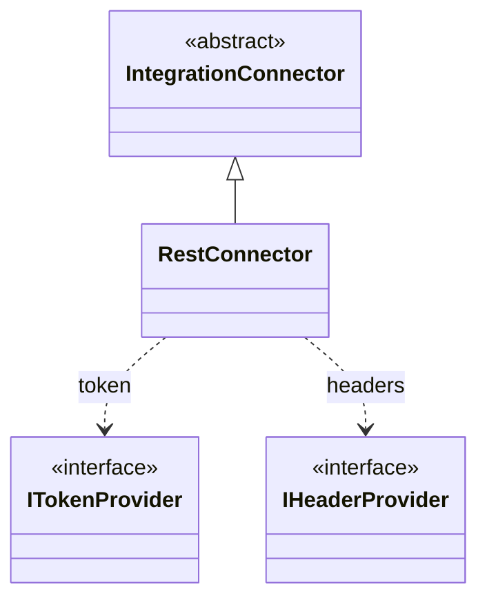

# IntegrationConnector

> Classe-base **abstrata** · `thl-lib.integration.connectors.types.IntegrationConnector` · `Fontes\thl-lib\integration\connectors\types\IntegrationConnector.cls` · volta ao [hub de arquitetura](../arquitetura.md)

## Papel

Transporte técnico de uma [OutboundMessage](OutboundMessage.md) até o sistema externo. `ConnectorFactory` escolhe a implementação pelo `ConnectorTypeEnum`; `ConnectorService` a executa. Autenticação e cabeçalhos são plugáveis: [ITokenProvider](ITokenProvider.md) e [IHeaderProvider](IHeaderProvider.md).

## Contrato para as filhas

```abl
method public abstract ConnectorResponse execute ( connectorRequest as ConnectorRequest ).
```

## Hierarquia



## Filhas

| Classe | Tipo (`ConnectorTypeEnum`) |
|---|---|
| `RestConnector` | `REST` — única implementada |

Em `ConnectorFactory` há `SoapConnector`, `DatabaseConnector` e `FileConnector` apenas **comentados** (não existem).

## Relacionados

[ITokenProvider](ITokenProvider.md) · [IHeaderProvider](IHeaderProvider.md) · [integration/connectors.md](../integration/connectors.md)
