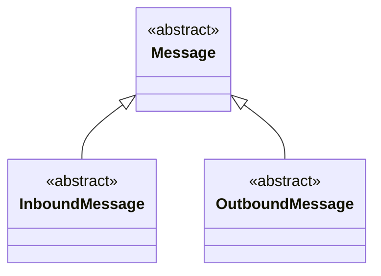

# Message

> Classe-base **abstrata** · `thl-lib.integration.messaging.core.Message` · `Fontes\thl-lib\integration\messaging\core\Message.cls` · volta ao [hub de arquitetura](../arquitetura.md)

## Papel

Raiz de toda mensagem de integração, nos dois sentidos. Concentra o que é comum a inbound e outbound: identificação (aplicação, objeto, operação, método, conector), payload JSON, persistência em `thl-mensagem` / `thl-mensagem-conteudo` / `thl-mensagem-historico` (via `MessageRepository`) e registro da resposta.

## Contrato para as filhas

Não declara métodos abstratos — é abstrata para não ser instanciada direto. As filhas diretas definem o sentido:

| Membro | Uso |
|---|---|
| `payload` (protected, `JsonConstruct`) | Conteúdo montado/recebido |
| `referenceCode` / `externalReferenceCode` (protected set) | Chave do registro no Datasul / no sistema externo |
| `createMessage()`, `saveContent()`, `saveContentByType(...)` | Gravação da mensagem e do conteúdo |
| `saveResponse(ConnectorResponse, ...)` | Grava a resposta (sobrescrito em `OutboundMessage`) |
| `setSuccessPayload(statusCode, ...)`, `getPayloadContent()` | Resposta devolvida ao chamador |
| `loadByMessageCode(...)`, `reuseMessage()` | Reprocessamento / reaproveitamento |

## Hierarquia

## Filhas

| Filha | Sentido | Nota |
|---|---|---|
| `InboundMessage` | Sistema externo → Datasul | [InboundMessage](InboundMessage.md) |
| `OutboundMessage` | Datasul → sistema externo | [OutboundMessage](OutboundMessage.md) |

## Relacionados

[integration/messaging-core.md](../integration/messaging-core.md) · [data/schema.md](../data/schema.md)
