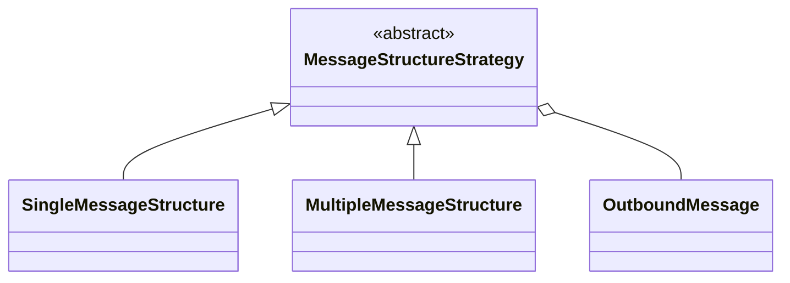

# MessageStructureStrategy

> Classe-base **abstrata** (Strategy) · `thl-lib.integration.messaging.outbound.strategy.MessageStructureStrategy` · `Fontes\thl-lib\integration\messaging\outbound\strategy\MessageStructureStrategy.cls` · volta ao [hub de arquitetura](../arquitetura.md)

## Papel

Define **como** uma [OutboundMessage](OutboundMessage.md) é estruturada: uma mensagem com um objeto, ou uma mensagem com vários objetos em array. `MessageFactory` escolhe a estratégia pela configuração do objeto (`isSingle`) e a entrega ao `OutboundMessageService`.

## Contrato para as filhas

Construtor: `(outboundMessage as OutboundMessage)`.

| Método abstrato | Chamado em |
|---|---|
| `buildMessage()` | `beginBuild` |
| `addObject(objectContext as OutboundObjectContext)` | `addObject` — chama `outboundMessage:loadData(objectContext)` |
| `finishMessage()` | `finishBuild` |

## Hierarquia

## Filhas

| Classe | Comportamento |
|---|---|
| `SingleMessageStructure` | Payload objeto — um registro por mensagem |
| `MultipleMessageStructure` | Payload array — vários registros na mesma mensagem |

Ambas em `thl-lib.integration.messaging.outbound.strategy`. Não há estratégias em `thl-extensions`.

## Relacionados

[OutboundMessage](OutboundMessage.md) · [integration/messaging-outbound.md](../integration/messaging-outbound.md)
