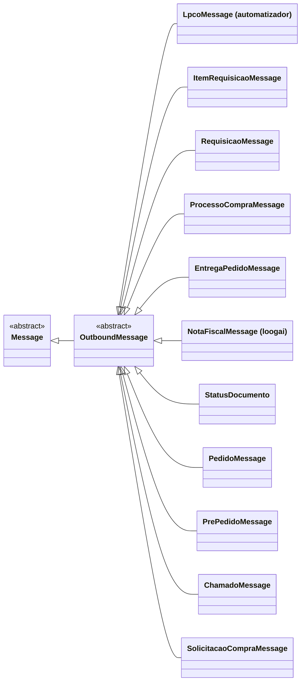

# OutboundMessage

> Classe-base **abstrata** · `thl-lib.integration.messaging.outbound.core.OutboundMessage` · herda de [Message](Message.md) · `Fontes\thl-lib\integration\messaging\outbound\core\OutboundMessage.cls` · volta ao [hub de arquitetura](../arquitetura.md)

## Papel

Mensagem **enviada** do Datasul a um sistema externo. É montada por uma [MessageStructureStrategy](MessageStructureStrategy.md) (uma mensagem por registro ou várias em um array) e enviada por um [IntegrationConnector](IntegrationConnector.md), a partir do `OutboundMessageService(aplicacao, objeto, operacao)` → `beginBuild` → `addObject` → `finishBuild` → `process`.

## Contrato para as filhas

| Membro | Obrigatório? | Uso |
|---|---|---|
| `onLoadData(register as recid)` → `character` | **abstrato** | Lê o registro Datasul e monta o `payload`; devolve o código de referência |
| `parseBusinessProcess(response)` → `logical` | opcional | Trata a resposta do sistema externo (ex.: gravar ID retornado) |
| `setPathParameter(nome, valor)` | apoio | Parâmetros de caminho da URL |
| `saveResponse(...)` | já sobrescrito aqui | Grava resposta e chama `applyBusinessProcess` |

`loadData(OutboundObjectContext)` é chamado pela estratégia e delega a `onLoadData`.

## Hierarquia

## Filhas

Todas em `thl-extensions.integration.<sistema>.messaging.outbound.message` — `thl-lib` não tem outbound concreta.

| Sistema | Classes |
|---|---|
| [automatizador](../extensions/automatizador.md) | `LpcoMessage` |
| [gestaoepi](../extensions/gestaoepi.md) | `ItemRequisicaoMessage`, `RequisicaoMessage` |
| [iacompras](../extensions/iacompras.md) | `ProcessoCompraMessage` |
| [loogai](../extensions/loogai.md) | `EntregaPedidoMessage`, `NotaFiscalMessage`, `StatusDocumento` |
| [mmcm](../extensions/mmcm.md) | `PedidoMessage`, `PrePedidoMessage` |
| [ninahub](../extensions/ninahub.md) | `ChamadoMessage` |
| [powerautomate](../extensions/powerautomate.md) | `SolicitacaoCompraMessage` |

⚠️ Nomes repetidos em pacotes diferentes: `LpcoMessage` (inbound e outbound do automatizador) e `NotaFiscalMessage` (inbound genérica × outbound loogai). Sempre usar o nome completo do pacote em `thl-objeto.classe-objeto`.

## Relacionados

[MessageStructureStrategy](MessageStructureStrategy.md) · [IntegrationConnector](IntegrationConnector.md) · [integration/messaging-outbound.md](../integration/messaging-outbound.md)
