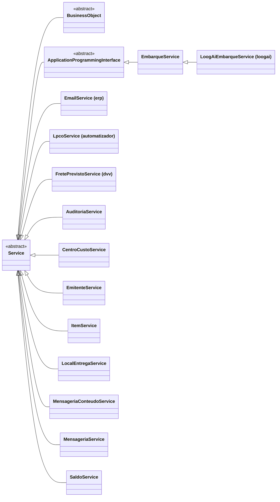

# Service

> Classe-base **abstrata** · `thl-lib.erp.core.Service` · `Fontes\thl-lib\erp\core\Service.cls` · volta ao [hub de arquitetura](../arquitetura.md)

## Papel

Contrato da **regra de negócio ERP** executada por uma [InboundMessage](InboundMessage.md) (via `createService()`). Não existe interface `IService`: o contrato é esta classe abstrata. É também a raiz das sub-bases que encapsulam APIs Datasul: [BusinessObject](BusinessObject.md) (BOs com `RowErrors`) e `ApplicationProgrammingInterface` (APIs com tabela de erros).

## Contrato para as filhas

```abl
method public JsonObject execute ( input  action        as ActionEnum,
                                   input  operation     as character ,
                                   input  context       as JsonObject,
                                   output referenceCode as character ).
```

| Membro | Obrigatório? | Uso |
|---|---|---|
| `loadReferenceCode()` → `character` | **abstrato** | Código do registro afetado (vira `referenceCode` da mensagem) |
| `getEntityName()` → `character` | **abstrato** | Nome da entidade para mensagens/log |
| `initialize()` | opcional | Preparação antes da ação |
| `create()` / `update()` / `delete()` | opcional | Uma por `ActionEnum` |
| `buildResponse(action, …)` | opcional | Monta o `JsonObject` devolvido |
| `inContext` / `outContext` | apoio | Entrada e saída da execução |

## Hierarquia



## Filhas

**Sub-bases abstratas (`thl-lib.erp.core`):**

| Classe | Encapsula | Filhas |
|---|---|---|
| [BusinessObject](BusinessObject.md) | BOs Datasul — `throwRowErrorsIfAny(methodName)` | 5 (+ netas) |
| `ApplicationProgrammingInterface` | APIs Datasul — `throwApiErrorsIfAny(methodName)` | `EmbarqueService` → `LoogAiEmbarqueService` ([loogai](../extensions/loogai.md)) |

**Concretas diretas em `thl-lib.erp.service`** (6): `CentroCustoService`, `EmitenteService`, `ItemService`, `LocalEntregaService`, `SaldoService`, `TransporteService`. (`AuditoriaService`, `EmailService`, `MensageriaService` e `MensageriaConteudoService` passaram para `thl-extensions.erp.thl.service` — conferido em disco em 2026-10-02.)

**Concretas diretas em `thl-extensions.erp.<sistema>.service`:** `LpcoService` ([automatizador](../extensions/automatizador.md)), `FretePrevistoService` ([dvv](../extensions/dvv.md)), `AmbienteService`, `ParametroAmbienteService`, `ParametroVariavelService`, `ParametroProgramaService`, `AplicacaoService`, `AuditoriaService`, `EmailService`, `MensageriaService`, `MensageriaConteudoService`, `AuditoriaTabela*Service` (5), `ConexaoRest*Service` (4), `ObjetoService`, `ObjetoParametroService`, `ObjetoUsuarioService`, `InboundRotaService`, `EmailParametroService`, `GrupoEmailService`, `GrupoEmailUsuarioService` ([thl](../extensions/thl.md)).

⚠️ `thl-extensions.erp.thl.service.EmailService` (serviço ERP chamado pela `EmailMessage`) não é o mesmo que `thl-lib.communication.email.EmailService` (envio de e-mail) — ver [communication/email.md](../communication/email.md).

## Relacionados

[InboundMessage](InboundMessage.md) · [BusinessObject](BusinessObject.md) · [erp/erp-services.md](../erp/erp-services.md)
