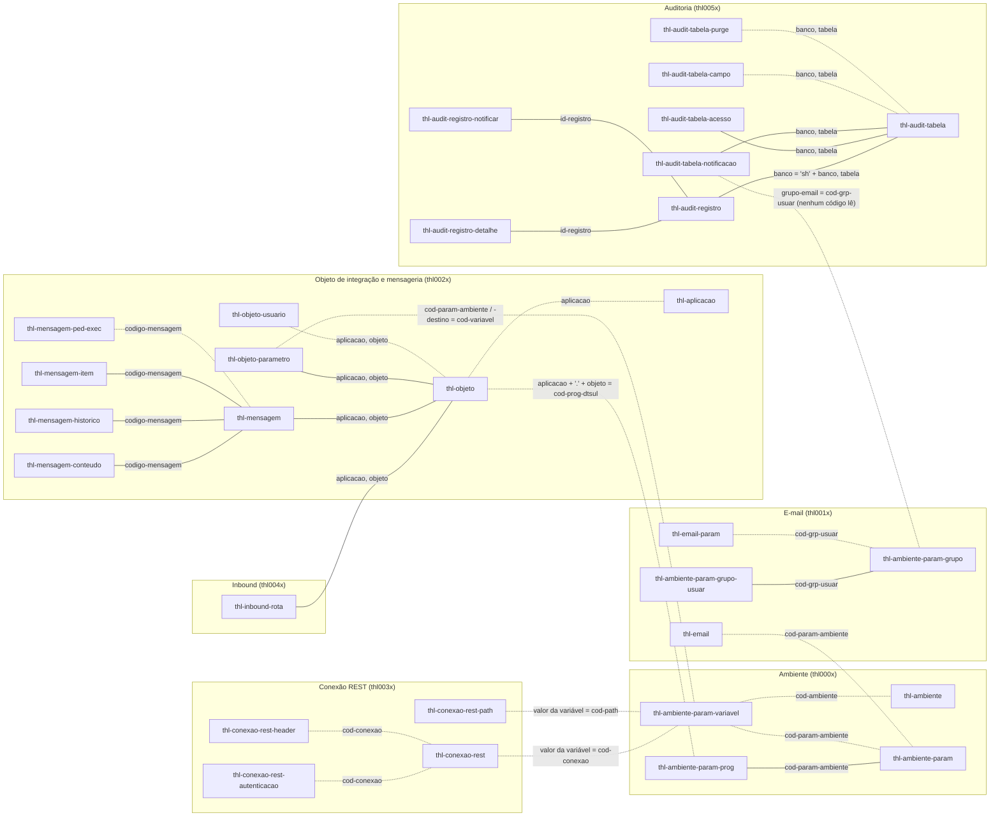

# Vínculos entre as tabelas THL

> Nota criada em 2026-09-25. Mostra **só se existe vínculo** entre tabelas `thl-*` (sem cardinalidade e sem as tabelas do ERP). Campos completos, índices e divergências: [schema.md](schema.md).
>
> **Gerado** por `Utils/scripts/gerar-er-diagrama.py` a partir do `Database/thl.df` — não editar o bloco entre os marcadores à mão. Depois de mudar o `.df`, rode `python Utils/scripts/gerar-er-diagrama.py` na raiz do repositório.

## Como ler

- **Linha contínua:** há índice `fk-*` no `.df` (vínculo declarado pela convenção de índices — [convencoes.md §6](../convencoes.md)).
- **Linha tracejada:** não há índice; o vínculo existe só no código (`OF`, `where a.x = b.x`) ou **por valor** (o código de uma tabela guardado como texto em outra). Nada no banco garante que o valor exista.
- O rótulo da linha são os campos da ligação.
- Os grupos seguem as dezenas da numeração dos programas ([convencoes.md §7](../convencoes.md)).

<!-- er-diagrama:inicio -->

<!-- er-diagrama:fim -->

## O que o diagrama mostra (achados de 2026-09-25)

- **`thl-conexao-rest-path` não pertence a uma conexão.** O `ConnectorConfig` lê `cod-conexao` e `cod-path` como valores de **duas variáveis de ambiente distintas**; o mesmo path pode ser usado com qualquer conexão. (Guia corrigido em 2026-09-25.)
- **Conexão REST só se liga ao resto por valor**, através de `thl-ambiente-param-variavel`. Caminho completo: `thl-objeto` → `thl-ambiente-param-prog` (programa `aplicacao.objeto`) dá o parâmetro; `thl-objeto-parametro.cod-param-ambiente` e `-destino` são **códigos de variável** desse parâmetro (apesar do nome); o **valor** das variáveis é o `cod-conexao` e o `cod-path`. Passo a passo em `Documentos/tecnico/guia-configuracao-conector-rest.md` §3.
- **`thl-aplicacao`** só está ligada a `thl-objeto` (zoom no thl0021). As demais tabelas carregam `aplicacao` como parte da chave do objeto (`aplicacao, objeto`); nada valida o valor contra o cadastro.
- **`thl-audit-registro.banco` tem o prefixo `sh`** (nome do banco na sessão, gravado pelo `AuditLogService`); a configuração (`thl-audit-tabela*`) guarda sem ele. O índice `fk-audit-tabela` existe, mas a ligação é `registro.banco = 'sh' + tabela.banco`.
- **`thl-audit-tabela-notificacao.grupo-email`** aponta para o grupo de e-mail só pela descrição do `.df`: nenhum código lê o campo (a notificação por grupo ainda não existe).
- **Sem índice `fk-*`** em vínculos usados no código: `thl-objeto-usuario` → `thl-objeto`, `thl-mensagem-ped-exec` → `thl-mensagem`, `thl-audit-tabela-campo`/`-purge` → `thl-audit-tabela`, `thl-ambiente-param-variavel` → ambiente/parâmetro. Em parte deles a própria `pk-` cobre a busca (os campos do pai vêm primeiro), por isso não há problema de desempenho — é só o vínculo que não fica declarado.

## Fora do diagrama (ERP)

`cod-usuario` (usuário Datasul em `thl-objeto-usuario`, `thl-ambiente-param-grupo-usuar`, `thl-audit-tabela-acesso`), `cod-prog-dtsul` (programa Datasul), `num-ped-exec` (pedido RPW) e `banco`/`tabela` da auditoria (a tabela auditada do ERP).
