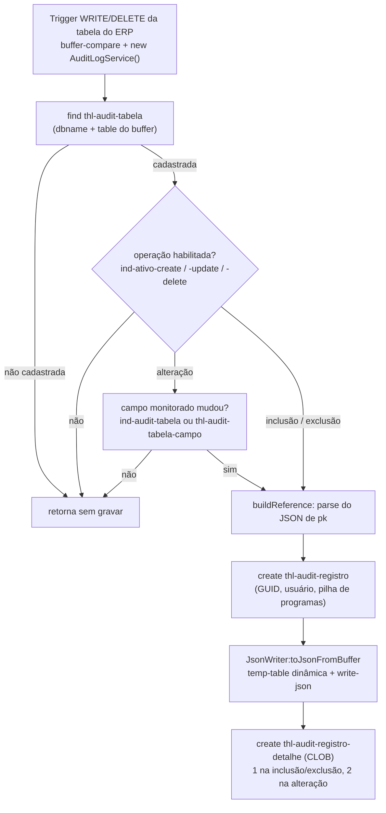

# Módulo de auditoria — visão de ponta a ponta

> **Análise de 2026-10-02**, por leitura do código (nada foi compilado nem medido). Detalhe de cada classe: [logging.md](logging.md) (gravação), [../erp/erp-services.md](../erp/erp-services.md) (consulta), [../extensions/thl.md](../extensions/thl.md) (API dos cadastros), [../thl/camada-datasul.md](../thl/camada-datasul.md) (telas e expurgo), [../data/schema.md](../data/schema.md) (tabelas e índices).

## 1. Peças do módulo

| Papel | Onde | Classes / programas |
|---|---|---|
| **Gravação** (dentro da transação do ERP) | `thl-lib.logging.audit` | `AuditLogService`, `AuditOperationEnum`, `AuditSnapshotEnum`; usa `thl-lib.util.json.JsonWriter` e `thl-lib.core.context.ContextService` |
| **Consulta** (API REST, só GET) | `thl-extensions.erp.thl.service` / `thl-extensions.integration.thl.messaging.inbound.message` | `AuditoriaService`, `AuditoriaMessage` (rota `auditoria`) |
| **Cadastro** (API REST, CRUD) | idem | `AuditoriaTabela`, `AuditoriaTabelaCampo`, `AuditoriaTabelaAcesso`, `AuditoriaTabelaNotificacao`, `AuditoriaTabelaExpurgo` — cada uma com `…Service` e `…Message` |
| **Telas Datasul** | `Fontes\thl` | thl0050 / thl0051 (+b/c/d/e/h) cadastro, thl0150 (+b) consulta, thl0250 + `thl0250rp.p` expurgo |
| **Web** | `Fontes\web` | feature `auditoria` (app de consulta) e cadastro Auditoria no motor genérico (app de cadastro) — ver [../web/app-web.md](../web/app-web.md) |

São 11 classes: 3 em `thl-lib` e 8 em `thl-extensions` (`AuditoriaService`, `AuditoriaMessage`, os 5 Services de cadastro e a `AuditoriaTabelaMessage`, que desde 2026-10-02 atende o pai e os quatro filhos — ver [../extensions/thl.md](../extensions/thl.md)). Não há trigger real no repositório — só os exemplos em `Utils\example\exampleAuditTriggerWrite.p` e `exampleAuditTriggerDelete.p` (este comentado e com a assinatura antiga).

## 2. Fluxo de gravação

O chamador entrega um **buffer de banco** (`handle`). O `write-json` da linguagem só existe para temp-table e ProDataSet, por isso o `JsonWriter` copia o registro para uma temp-table dinâmica antes de serializar — a temp-table é interna ao utilitário, não faz parte do contrato da trigger.

## 3. Achados

### Defeitos (por leitura)

| # | Onde | Achado |
|---|---|---|
| D1 | `AuditLogService.cls:43-52` | **Inclusão gravada como alteração.** Com `ind-ativo-create = no`, `ind-ativo-update = yes` e `ind-audit-tabela = yes`, um registro novo cai no `else`, passa em `hasChangedMonitoredField` e é gravado como `Atualizacao`, com `campos` vazio e snapshot "Anterior" do buffer antigo. Falta sair quando `newRecord` é verdadeiro e a inclusão não está habilitada. |
| D2 | `thl0250rp.p:130` | **Expurgo não encontra registros.** Compara `thl-audit-registro.banco` com o banco do cadastro sem o prefixo `sh` que o `AuditLogService` grava. O changelog de 2026-09-25 registra essa correção; o fonte atual não a tem. ⚠️ A confirmar com o responsável se foi revertido de propósito. |
| D3 | `thl0250rp.p:149` | Grava `dt-ultima-execucao` em `thl-audit-tabela-purge` lido com `no-lock` — erro em tempo de execução ao gravar. |
| D4 | `AuditLogService.cls` | Classe **sem** `block-level on error undo, throw`. |
| D5 | `AuditLogService.cls:209`, `thl0150.w:708` | `matches '*campo*'` para testar campo alterado: `cod` casa com `cod-estab` (falso positivo). `AuditoriaService.filterSnapshot` já usa `lookup`, que é o correto. |

### Riscos e inconsistências

- **Prefixo `sh`.** O cadastro guarda o banco sem prefixo; o registro grava `'sh' + dbname`. Quatro pontos refazem a conta (`AuditLogService:171`, `AuditoriaService:67`, `thl0150.w:92/110/309`, e deveria estar no `thl0250rp.p`). O `thl0150.w:693` usa o valor com `sh` para abrir `_File` no schema holder — é a origem do prefixo, e pressupõe DataServer.
- **Identidade pela conexão.** A chave do cadastro é o nome lógico do banco na sessão (`buffer:dbname`). Alias diferente entre ambientes = auditoria deixa de gravar sem erro.
- **`id` × `id-registro`.** `AuditLogService` e `AuditoriaService` usam `id` (abreviação do campo `id-registro`); `thl0150.w:706` usa `campo` para `campos`. Quebra com `-require-full-names`.
- **Notificação não existe.** `thl-audit-tabela-notificacao` tem cadastro (tela, API, web), mas nenhum código lê `grupo-email` nem grava `thl-audit-registro-notificar`; só o expurgo apaga essa tabela.
- **Sensibilidade da tabela.** A tela thl0150 filtra `thl-audit-tabela.nivel-sensibilidade <= nivel-acesso`; a API (`AuditoriaService`) não — só oculta campos restritos. O buffer `b-tabela` está declarado e não é usado.
- **`AuditoriaMessage`.** O cabeçalho diz "limite 200 registros"; o código usa `createPagination( 1000 )`.
- **`FretePrevistoService` (dvv).** Tem `using AuditLogService` e comentários sobre auditoria, mas não chama o serviço — ver [../extensions/dvv.md](../extensions/dvv.md).
- **Cabeçalho do `AuditLogService.cls`** cita `thl-audit-campo-tabela`, nome que não existe.

## 4. Desempenho da gravação

Objetivo declarado pelo responsável (2026-10-01): a trigger deve pesar o mínimo possível no ERP. Tamanho da tabela de registros **não** é preocupação — o expurgo (thl0250) cuida do crescimento; por isso o snapshot continua sendo o registro inteiro.

### O que cada gravação paga hoje

| Etapa | Quem paga | Observação |
|---|---|---|
| `new AuditLogService()` | toda gravação | barato: r-code carregado uma vez por sessão |
| `find thl-audit-tabela` | **toda** gravação, auditada ou não | sem cache; em DataServer é uma ida ao banco |
| parse do JSON de `pk` | gravação auditada | `ObjectModelParser` novo a cada vez |
| `can-find` + `matches` em `thl-audit-tabela-campo` | alteração de tabela não auditada inteira | lê os campos ativos da tabela |
| temp-table dinâmica (`create-like-sequential` + `temp-table-prepare` + destruição) | gravação auditada; **em dobro** na alteração | parte cara do `toJsonFromBuffer` |
| `write-json` formatado | gravação auditada | `prettyPrint` é ignorado (`true` fixo) |
| `run thl/api/geterpuser.p` + pilha de programas | gravação auditada | barato; o `.p` só devolve uma variável global |
| inclusões | gravação auditada | 1 cabeçalho (4 índices) + 1 ou 2 detalhes com CLOB (2 índices) |

### Plano proposto (não implementado)

Registrado como ADR em [../adr/auditoria-desempenho-trigger.md](../adr/auditoria-desempenho-trigger.md) (status: proposta).

| # | Mudança | Onde | Efeito sobre o que é gravado |
|---|---|---|---|
| P1 | Cadastro em memória por sessão (temp-table estática), incluindo "tabela não auditada", com validade de alguns minutos | `AuditLogService` | nenhum |
| P2 | Lista de campos de `pk` e de campos monitorados já interpretada, no mesmo cache | `AuditLogService` | nenhum |
| P3 | Temp-table de serialização preparada uma vez por tabela e reaproveitada; continua recebendo buffer e usando `write-json` | `JsonWriter` ou `AuditLogService` | nenhum |
| P4 | Respeitar `prettyPrint`; a auditoria grava sem formatação | `JsonWriter` | mesmo JSON, sem espaços |
| P5 | Remover `idx-audit-data` (sem consulta no repositório) | `.df` (Data Dictionary) | nenhum |
| P6 | Os dois snapshots da alteração em um único detalhe | `AuditLogService` + leitores | **muda o formato** — só com medição |

Restrições:
- O formato `{"<tabela>":[{…}]}` precisa ser mantido: `thl0150.w` faz `read-json` e `AuditoriaService` lê o primeiro nome como array.
- No PASOE a sessão atende vários usuários: o **usuário Datasul não pode ser guardado no cache** de sessão.
- Handles estáticos vivem enquanto a sessão viver; mudança de schema da tabela auditada exige reiniciar os agentes (já é assim para r-code).
- A conferir no PDSOE: `buffer:serialize-row()` em buffer de banco dispensaria a temp-table, mas o formato de saída é outro (objeto único, não array) e a disponibilidade para buffer de banco **não foi confirmada**.

### Medição

Laço de alguns milhares de alterações com `etime` em três situações — sem trigger, com trigger e tabela não auditada, com auditoria ativa — antes e depois de cada mudança.

## 5. Expurgo

`thl0250rp.p` percorre `thl-audit-tabela-purge` pela faixa de banco/tabela e apaga registro + detalhe + notificar anteriores a hoje − `retencao-dias`, por `idx-tabela-data`, uma transação por registro. Fica fora do caminho da trigger.

- Tabela auditada **sem** registro de expurgo, ou com retenção 0, é ignorada e cresce sem limite — não há retenção padrão.
- Defeitos D2 e D3 acima: pela leitura, o expurgo hoje não apaga nada.

## 6. Decisões em aberto

1. `thl0250rp.p` sem o `sh`: reversão intencional ou perda da correção?
2. Implementar P1–P4 (sem mudança de contrato) — tarefa para a skill `thl-coding`.
3. P5: remover `idx-audit-data` do `.df`.
4. Identidade do banco: normalizar o prefixo `sh` em um único ponto, ou passar a identificação explícita pela trigger.
5. Retenção padrão para tabela auditada sem registro de expurgo.
6. Notificação por grupo de e-mail: implementar ou retirar o cadastro.

## Snapshot ilegível na listagem (2026-10-13, não compilado)

`AuditoriaService:parseSnapshot` lê o JSON de `thl-audit-registro-detalhe.valor` (CLOB `iso8859-1`, copiado para um `longchar` `UTF-8`). JSON inválido num registro (erro 16068 do analisador, "Erro do analisador Json no offset N") derrubava a **listagem inteira**. Agora o registro ruim é logado (`LogUtil`: id, tipo, tamanho e mensagem, no log do AVM quando ativo), o snapshot sai vazio e o item ganha `snapshotInvalido: true`; os demais itens seguem. A causa do JSON inválido nos dados continua em aberto: depende de inspecionar o registro logado.
