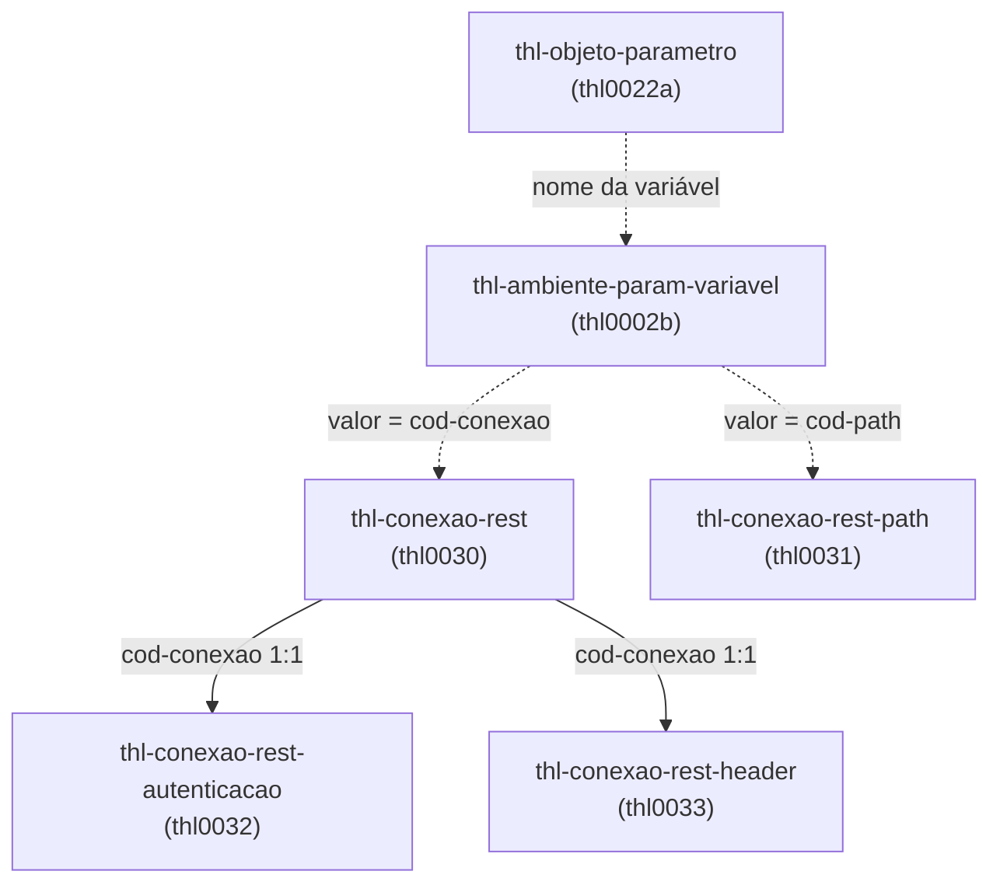

# thl003 — Conexão REST

Voltar: [[Cadastros THL]]

## Propósito do grupo

Cadastros que descrevem **para onde e como** a biblioteca chama uma API externa nas integrações de **saída**: servidor (conexão), endpoint (path), autenticação e cabeçalhos calculados. Conexão e path são escolhidos em runtime por **duas variáveis de ambiente** do objeto de integração (ver [fluxo-saida](../../../.claude/fluxos/fluxo-saida.md)): `url-base` (conexão) + `path` (endpoint) formam a URL final.

| Programa | Tabela | Papel |
|---|---|---|
| [[thl0030 Conexões REST]] | `thl-conexao-rest` | URL base e indicadores que ligam autenticação e cabeçalho |
| [[thl0031 Paths da conexão]] | `thl-conexao-rest-path` | Endpoint reutilizável (path, content-type, accept, timeout, parâmetros, cabeçalhos fixos) |
| [[thl0032 Autenticação da conexão]] | `thl-conexao-rest-autenticacao` | Tipo de autenticação, credenciais, serviço e parser de token |
| [[thl0033 Header provider da conexão]] | `thl-conexao-rest-header` | Classe que calcula cabeçalhos (ex.: HMAC) e seus parâmetros |

## Ordem de cadastro recomendada

1. [[thl0031 Paths da conexão]] — independente; pode ser feito antes ou depois da conexão.
2. [[thl0030 Conexões REST]] — informe a URL base; marque *Requisita Autenticacao* / *Requer Cabeçalho* **só se for cadastrar o complemento**.
3. [[thl0032 Autenticação da conexão]] — se a conexão requisita autenticação.
4. [[thl0033 Header provider da conexão]] — se a conexão requer cabeçalho calculado.
5. Fora do grupo: gravar o **código da conexão** e o **código do path** como valores de variáveis de ambiente (thl0002b), e apontar o nome dessas variáveis no objeto (thl0022a). O vínculo programa → parâmetro `APLICACAO.OBJETO` (thl0002c) é obrigatório.

## Diagrama

Linha contínua = vínculo por `cod-conexao` (sem `fk-*` no banco); tracejada = vínculo só por valor de variável de ambiente.

Eliminar a conexão elimina autenticação e cabeçalho (cascata no thl0030); path, variáveis de ambiente e objetos não são tocados.

## Armadilhas do grupo

- Marcar *Requisita Autenticacao* ou *Requer Cabeçalho* sem cadastrar o complemento só falha **em runtime**, no primeiro envio.
- `senha` fica visível na tela e sem criptografia no banco; o token obtido não é gravado de volta (ver [[thl0032 Autenticação da conexão]]).
- Classes dos thl0032 e thl0033 são carregadas por nome (`dynamic-new`): renomear/mover exige atualizar o cadastro.
- ⚠ `timeout` do path e `parameters` do path têm unidade/formato diferentes do documentado ([[thl0031 Paths da conexão]]).
